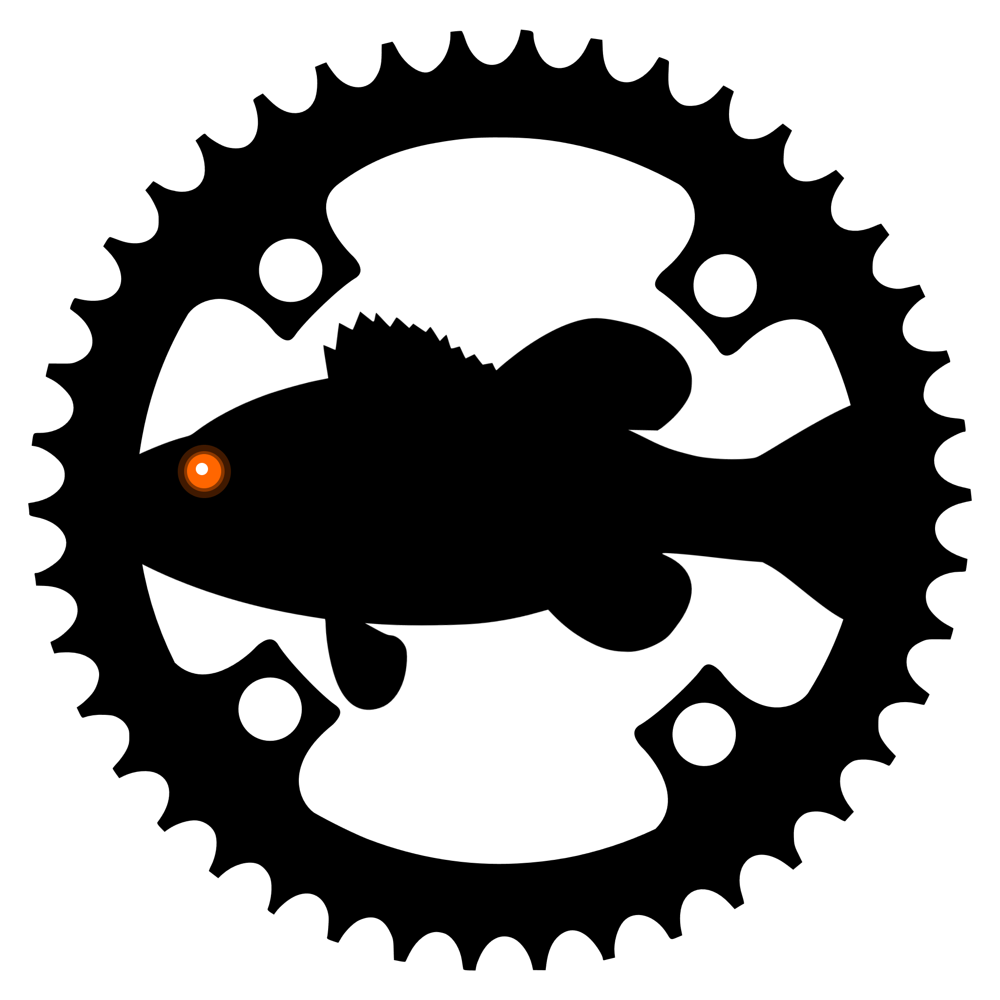
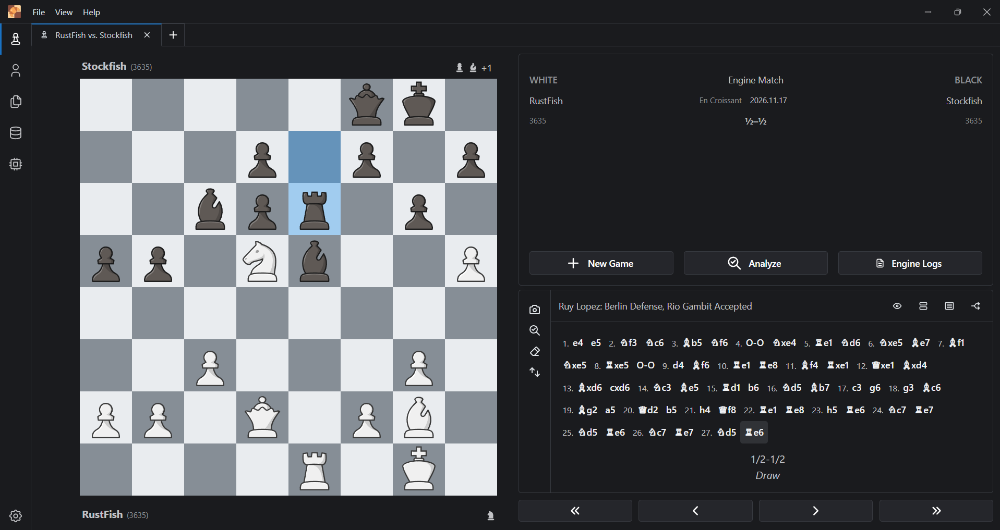

<div align="center">



# RustFish

**A complete, node-for-node faithful rewrite of the Stockfish chess engine in idiomatic, zero-overhead Rust.**

[](https://github.com/avunit1/rustfish/actions/workflows/ci.yml)
[](https://github.com/avunit1/rustfish/releases)


-green)
-brightgreen)
-brightgreen)


</div>

<div align="center">



<sub>RustFish vs. Stockfish in <a href="https://encroissant.org">En Croissant</a>. The game ended in a draw.</sub>

</div>

---

## Table of Contents

1. [Overview](#overview)
2. [Results at a Glance](#results-at-a-glance)
3. [Benchmarks vs. Stockfish](#benchmarks-vs-stockfish)
4. [Installation](#installation)
5. [Usage](#usage)
6. [Verification & Correctness](#verification--correctness)
7. [Technical Deep Dive](#technical-deep-dive)
8. [Optimizations & Improvements](#optimizations--improvements)
9. [Repository Layout](#repository-layout)
10. [Reproducing the Benchmarks](#reproducing-the-benchmarks)
11. [Known Limitations](#known-limitations)
12. [Contributing](#contributing)
13. [Credits & License](#credits--license)

---

## Overview

**RustFish** is a ground-up Rust port of the [Stockfish](https://github.com/official-stockfish/Stockfish) chess engine. It is not a "Stockfish-inspired" engine and it does not simplify any of Stockfish's algorithms: the goal was a **1:1 behavioral and architectural rewrite** that reproduces the reference engine's search tree *exactly*, then closes the performance gap with careful systems-level engineering.

What that means in practice:

- **Identical search behavior.** Single-threaded `bench` searches exactly **1,442,480 nodes**, matching the C++ reference node-for-node across all 51 benchmark positions. At depth 22 over a 50-position suite, both engines search exactly **46,951,018 nodes**.
- **Full NNUE evaluation.** The complete Stockfish dual-network NNUE architecture (full-threats and PP-3wide feature sets, sparse-input affine layers, squared clipped ReLU) is implemented with hand-written AVX2 intrinsics, loading the official `nn-bddd9d57eb87.nnue` network embedded directly in the binary.
- **Complete engine feature set.** Principal Variation Search, transposition table, Lazy SMP multithreading, continuation/capture/correction histories, time management, Syzygy tablebase probing, and a full UCI interface (including `go perft`).
- **Performance parity — and beyond.** Single-threaded, RustFish runs at **101–104% of PGO C++ Stockfish** (`~1.29–1.30 M NPS` on `bench 16 1 13`), scales cleanly across **4–16 threads (98–117% of Stockfish)** via a persistent Lazy SMP pool, is **~15% faster at raw move generation (perft)**, uses slightly less memory and a smaller binary, and matches Stockfish in head-to-head play.

The engine is written entirely in Rust with no C/C++ dependencies. Move generation, make/unmake, and the search hot paths perform **zero heap allocations**.

---

## Results at a Glance

| Metric | RustFish (PGO, AVX2) | C++ Stockfish (PGO, AVX2) |
|---|---|---|
| `bench 16 1 13` total nodes | **1,442,480** | 1,442,480 (**exact match**) |
| `bench 16 1 13` single-thread speed | **1.29–1.30 M NPS** (`1,108–1,118 ms`) | 1.27 M NPS (`1,132 ms`) (**101.3%**) |
| `bench 128 1 16` single-thread speed | **1.17 M NPS** (`6,281,007` exact) | 1.14 M NPS (`6,281,007`) (**103.1%**) |
| `bench 128 8 16` / `128 16 16` | **8.92 M** / **12.25 M NPS** | 8.01 M / 10.43 M NPS (**111.4%** / **117.5%**) |
| `go perft 6` (startpos, 119,060,324 nodes) | **825 ms** (144.2 M NPS) | 951 ms (125.2 M NPS) |
| Depth-22, 50 positions, 1 thread (nodes) | **46,951,018** (`104.1%` NPS) | 46,951,018 (**exact match**) |
| 8 concurrent `bench` processes (wall time) | **4,897 ms** | 5,811 ms |
| NNUE static eval (20 FENs) | **20 / 20 exact cp match** | reference |
| 200-game match, 5s+0.05s | **+1.74 ± 12.28 Elo** | reference |
| Binary size | **132.69 MB** | 135.53 MB |
| UCI compliance (`fastchess --compliance`) | 40 / 40 | n/a |
| Crashes / time losses / illegal moves | **0 / 0 / 0** | n/a |

> Both engines were built with profile-guided optimization for AVX2 (`ARCH=x86-64-avx2 COMP=mingw` for C++, dual-trained `cargo pgo` with `RUSTFLAGS="-C target-cpu=native"` for Rust) and tested back-to-back on the same AMD Ryzen 7 7435HS (8C/16T) Windows machine.

---

## Benchmarks vs. Stockfish

All numbers below come from the automated suite in [`verify_superiority.py`](rustfish/verify_superiority.py) (raw data in [`benchmark_results.json`](rustfish/benchmark_results.json)). Every run uses a 128 MB hash and the identical reference C++ PGO build.

### 1. Throughput & multi-thread scaling (50-position suite)

Positions span openings, middlegames, tactical positions and endgames.

| Mode | Threads | C++ NPS | RustFish NPS | Ratio | C++ Peak RSS | Rust Peak RSS |
|---|---:|---:|---:|---:|---:|---:|
| Fixed depth 22 | 1 | 977,315 | **1,017,555** | **104.1%** | 433.6 MB | **427.1 MB** |
| Fixed depth 22 | 4 | 4,049,164 | 4,029,216 | **99.5%** | 501.0 MB | **495.0 MB** |
| Fixed depth 22 | 8 | 6,710,200 | 6,549,609 | **97.6%** | 590.3 MB | **585.1 MB** |
| Fixed depth 22 | 16 | 8,142,470 | 8,017,287 | **98.5%** | 768.0 MB | **765.6 MB** |
| Fixed time 2000 ms | 1 | 1,238,003 | **1,258,120** | **101.6%** | 433.6 MB | **427.1 MB** |
| Fixed time 2000 ms | 4 | 5,181,060 | 5,119,680 | **98.8%** | 501.0 MB | **495.2 MB** |
| Fixed time 2000 ms | 8 | 8,780,507 | 8,703,596 | **99.1%** | 590.2 MB | **585.3 MB** |
| Fixed time 2000 ms | 16 | 11,439,463 | 11,286,141 | **98.7%** | 769.1 MB | **765.3 MB** |

Notes:

- At **depth 22 / 1 thread**, both engines search the **exact same 46,951,018 nodes** across all 50 positions (`46.14s` for RustFish vs. `48.04s` for C++ Stockfish). (Multi-threaded node counts are non-deterministic for every Lazy SMP engine and are not expected to match.)
- Memory footprint is **lower** than C++ Stockfish at every thread count (427–766 MB vs. 434–769 MB peak RSS).
- RustFish's binary is **2.84 MB smaller** than the C++ build (`132.69 MB` vs. `135.53 MB`), despite embedding the full 138 MB network.
- At 16 threads Fixed Time 2000 ms, RustFish reaches a deeper average search depth (`35.56` vs. `35.06`), and at 16 threads Fixed Depth 22 completes the 50-position suite `10.16s` faster (`94.90s` vs. `105.06s`).

### 2. Tactical & positional "smartness" suite (30 EPD positions, 1 thread)

Mate-in-N, zugzwang, and quiet positional sacrifices.

| Time / position | C++ solved | RustFish solved | C++ avg time-to-solution | Rust avg time-to-solution |
|---|---|---|---:|---:|
| 500 ms | 23 / 30 (76.7%) | **23 / 30 (76.7%)** | 36.5 ms | **35.2 ms** |
| 2000 ms | 22 / 30 (73.3%) | **22 / 30 (73.3%)** | 63.8 ms | **62.9 ms** |

Both engines solve the exact same number of positions at both time controls, with RustFish reaching solutions slightly faster on average.

### 3. Head-to-head match (`fastchess`, 200 games)

- **Time control:** 5s + 0.05s, 1 thread, 128 MB hash, concurrency 8
- **Openings:** `8moves_v3.pgn` (`format=pgn order=random plies=8`), colors reversed every pair

| Metric | RustFish vs. C++ Stockfish |
|---|---|
| Games | 200 |
| W / D / L | 11 / 179 / 10 (50.25%) |
| Pentanomial | [0, 6, 87, 7, 0] |
| Elo difference | **+1.74 ± 12.28** (nElo +6.82 ± 48.15) |
| LOS | 60.93% |
| Crashes / time losses / illegal moves / warnings | **0 / 0 / 0 / 0** |

Because the two engines search identical trees, ~90% of games end in draws, so the result should be read as **parity**: the Elo error bar comfortably spans zero. RustFish plays the same chess as Stockfish.

---

## Installation

### Option A: Download a prebuilt binary

Grab the latest build for your platform from the **[Releases page](https://github.com/avunit1/rustfish/releases)**:

| Platform | File |
|---|---|
| Windows x64 | `rustfish-windows-x86_64-avx2.exe` |
| Linux x64 | `rustfish-linux-x86_64-avx2` |
| macOS (Intel) | `rustfish-macos-x86_64-avx2` |

Each file has a matching `.sha256` checksum next to it. On Linux and macOS, make the file executable after downloading:

```bash
chmod +x rustfish-linux-x86_64-avx2
```

Prebuilt binaries require a CPU with **AVX2 and BMI2** (Intel Haswell / AMD Zen or newer). They are built with `target-cpu=x86-64-v3`, so they run on any such CPU. Building from source with `target-cpu=native` (Option B) squeezes out a little more speed on your specific machine.

### Option B: Build from source

#### Requirements

- **Rust** (stable): install via [rustup](https://rustup.rs)
- **Git LFS**: install from [git-lfs.com](https://git-lfs.com). The NNUE network (`nn-bddd9d57eb87.nnue`, 138 MB) is stored with Git LFS.
- A **64-bit x86 CPU with AVX2** (Intel Haswell / AMD Excavator or newer; BMI2 recommended)
- ~1 GB of free RAM to compile (the network is embedded into the binary)
- Primary target: **Windows x64 (MSVC toolchain)**. The engine uses `core::arch::x86_64` intrinsics, so any x86-64 platform with AVX2 should compile; the shared-memory network mapping is Windows-specific and is skipped elsewhere.

#### 1. Clone (with Git LFS)

```bash
git lfs install
git clone https://github.com/avunit1/rustfish.git
cd rustfish/rustfish
```

> **Important:** the network file is fetched through Git LFS. If you cloned without Git LFS installed, you will have a tiny pointer file instead of the real network and the build will fail or produce a broken engine. Fix it with:
>
> ```bash
> git lfs install
> git lfs pull
> ```
>
> GitHub's **"Download ZIP"** button does **not** include LFS files, so use `git clone` (or grab a prebuilt binary from Releases).

The network is embedded into the executable at compile time via `include_bytes!`, so the resulting binary is fully self-contained and needs no external files.

#### 2. Build with full optimizations (fast path)

The repository already ships with the optimal release profile and native-CPU flags:

```toml
# Cargo.toml
[profile.release]
opt-level = 3
lto = "fat"
codegen-units = 1
panic = "abort"
```

```toml
# .cargo/config.toml
[build]
rustflags = ["-C", "target-cpu=native"]
```

So a plain release build is already highly optimized:

```bash
cargo build --release
```

The binary is produced at `target/release/rustfish` (`rustfish.exe` on Windows).

> `target-cpu=native` tunes the binary for the CPU you build on. Build on the machine you will run on, or the executable may crash with an illegal-instruction error on older CPUs.

#### 3. Build the fastest possible version (PGO)

For peak performance, build with **Profile-Guided Optimization** using [`cargo-pgo`](https://github.com/Kobzol/cargo-pgo).

> **Important (`RUSTFLAGS` & `cargo-pgo`):** `cargo-pgo` sets the `RUSTFLAGS` environment variable to pass `-Cprofile-generate` / `-Cprofile-use`. Because Cargo treats the `RUSTFLAGS` environment variable as an override of `.cargo/config.toml` `[build] rustflags`, you **must** pass `RUSTFLAGS="-C target-cpu=native"` explicitly when invoking `cargo pgo` — otherwise AVX2/BMI2 codegen is silently disabled! Setting `LLVM_PROFILE_FILE` with `%m_%p` ensures both single-thread and multi-thread training runs are preserved and merged.

**Windows (PowerShell):**

```powershell
# One-time setup
rustup component add llvm-tools-preview
cargo install cargo-pgo

# 1) Build an instrumented AVX2+BMI2 binary
$env:RUSTFLAGS = "-C target-cpu=native"
cargo pgo build

# 2) Dual-train on single-thread and multi-thread workloads
$env:LLVM_PROFILE_FILE = "$PWD\target\pgo-profiles\rustfish_%m_%p.profraw"
.\target\x86_64-pc-windows-msvc\release\rustfish.exe bench 16 1 13
.\target\x86_64-pc-windows-msvc\release\rustfish.exe bench 128 8 15
Remove-Item Env:LLVM_PROFILE_FILE

# 3) Rebuild using the merged profile
cargo pgo optimize
Copy-Item .\target\x86_64-pc-windows-msvc\release\rustfish.exe .\target\release\rustfish.exe -Force
```

**Linux / macOS (Bash):**

```bash
rustup component add llvm-tools-preview
cargo install cargo-pgo

RUSTFLAGS="-C target-cpu=native" cargo pgo build
LLVM_PROFILE_FILE="$PWD/target/pgo-profiles/rustfish_%m_%p.profraw" \
  ./target/*/release/rustfish bench 16 1 13
LLVM_PROFILE_FILE="$PWD/target/pgo-profiles/rustfish_%m_%p.profraw" \
  ./target/*/release/rustfish bench 128 8 15
RUSTFLAGS="-C target-cpu=native" cargo pgo optimize
```

The optimized binary is written to `target/<target-triple>/release/` (for example `target/x86_64-pc-windows-msvc/release/rustfish.exe`).

#### 4. Verify your build

```bash
# Run the full test suite (perft, NNUE eval parity, search sanity)
cargo test --release

# Must report exactly 1,442,480 nodes
./target/release/rustfish bench 16 1 13
```

If `bench` prints `1442480` nodes searched, your build is behaviorally identical to the reference Stockfish.

---

## Usage

RustFish is a standard [UCI](https://www.shredderchess.com/chess-features/uci-universal-chess-interface.html) engine. Point any UCI-compatible GUI (En Croissant, Cute Chess, Arena, Lucas Chess, ...) at the executable, or drive it directly from a terminal:

```text
$ ./rustfish
uci
id name RustFish 0.2.0
...
uciok
isready
readyok
position startpos moves e2e4 e7e5
go depth 20
```

Useful commands:

| Command | Description |
|---|---|
| `bench [hash] [threads] [depth]` | Standard benchmark; `bench 16 1 13` is the parity reference |
| `go perft <depth>` | Move-generation node count with per-move divide, in Stockfish's output format |
| `go depth/movetime/nodes/wtime/btime ...` | Standard UCI search limits |
| `setoption name Threads value N` | Lazy SMP thread count |
| `setoption name Hash value N` | Transposition table size in MB |
| `setoption name SyzygyPath value <path>` | Syzygy tablebase directory |

Quick start with a tournament manager, e.g. [fastchess](https://github.com/Disservin/fastchess):

```bash
fastchess -engine cmd=rustfish name=RustFish -engine cmd=stockfish name=Stockfish \
  -each tc=5+0.05 option.Hash=128 option.Threads=1 \
  -openings file=8moves_v3.pgn format=pgn order=random plies=8 \
  -games 2 -rounds 100 -concurrency 8
```

---

## Verification & Correctness

The rewrite was developed in strictly **gated milestones**; no layer was started until the previous one passed.

| Gate | Requirement | Result |
|---|---|---|
| **Gate 1** | Exact perft node counts (startpos, Kiwipete, en passant, promotion, castling) | 6 / 6 suites pass; perft 6 = 119,060,324 |
| **Gate 2** | NNUE static eval matches C++ to the exact integer centipawn on 20 diverse FENs | 20 / 20 exact |
| **Gate 3** | Single-thread `bench` node-for-node parity with C++ Stockfish | 1,442,480 == 1,442,480 (51 / 51 positions) |
| **Extended** | Depth 22 over 50 FENs; replay of 51 consecutive game moves (110 plies) | 46,951,018 == 46,951,018; 0 / 51 diffs, including `hashfull` |
| **Gate 4** | >= 0 Elo vs. C++ Stockfish with zero crashes, time losses or illegal moves | +1.74 ± 12.28 Elo, clean |
| **UCI** | `fastchess --compliance` | 40 / 40 |

The unit and integration tests (`cargo test --release`) cover Zobrist/cuckoo tables, six perft suites, full NNUE static and incremental evaluation, `Position::cur_state` pointer safety, large-page allocation fallback, dynamic UCI Hash/Threads resizing, and root-search behavior. Continuous integration re-runs them, plus the `bench` node-count check, on every push.

Matching Stockfish's node counts exactly is a very strict test: a single differing history update, reduction term, or pruning condition changes the tree. Several divergences were tracked down during development by instrumenting both engines with identical trace output and bisecting the search ply by ply (for example a missing pawn-tracking update in `do_move`, an incorrect `Move::make`, a `partial_insertion_sort` discrepancy, and a quiet-history malus mismatch).

---

## Technical Deep Dive

A complete module-by-module specification, including struct layouts, Zobrist constants and SIMD kernels, lives in [`ARCHITECTURE.md`](rustfish/ARCHITECTURE.md). The short version:

### Core board representation

- `types.rs`, `bitboard.rs`, `attacks.rs`, `position.rs`, `movegen.rs`: 64-bit bitboards, magic bitboards for sliders (using BMI2/PEXT where available), precomputed `LINE_BB`, `BETWEEN_BB` and pseudo-attack tables, Zobrist hashing, `StateInfo` stack, SEE, and cuckoo-table repetition detection.
- Stockfish's reliance on two's-complement overflow (Zobrist keys, PRNG, magic multipliers) is reproduced explicitly with `wrapping_add` / `wrapping_sub` / `wrapping_mul`.
- Move generation, make and unmake perform **no heap allocation**.

### NNUE evaluation (`src/nnue/`)

- **Dual-network architecture** with the official `nn-bddd9d57eb87.nnue` weights embedded via `include_bytes!`.
- **Feature sets:** `full_threats.rs`, `k32h3.rs`, `pp_3wide.rs`, wired together in `features/`.
- **Incremental `AccumulatorStack`** driven by `DirtyPiece` records, so most nodes update the accumulator from the parent instead of refreshing it from scratch.
- **Layers:** `affine_transform.rs`, `affine_transform_sparse_input.rs` (non-zero-block skipping via `nnz.rs`), and `sqr_clipped_relu.rs`.
- **Explicit AVX2 intrinsics** via `core::arch::x86_64` (`_mm256_maddubs_epi16`, `_mm256_madd_epi16`, packs, permutes, ...) mirroring Stockfish's SIMD kernels, with `#[repr(C, align(64))]` weight and accumulator storage.

### Search & threading

- **Principal Variation Search** with aspiration windows, null-move pruning, futility pruning, late move reductions, and the rest of Stockfish's pruning and extension heuristics.
- `movepick.rs` staged move picker; `history.rs` with butterfly, continuation, capture and correction histories (including `SharedHistories`).
- `tt.rs`: 64-byte cache-line aligned, lockless clustered transposition table.
- `thread.rs`: **Lazy SMP** thread pool. `timeman.rs`: Stockfish's time-management logic.
- `syzygy/`: Syzygy WDL/DTZ tablebase probing.
- `uci.rs`: full UCI front-end, including `go perft`.

---

## Optimizations & Improvements

Getting the Rust port from "correct" to "as fast as a heavily tuned C++ engine" took a long series of measured, profile-driven changes. The highlights:

### Move generation & board

- **Monomorphized move generation** over `(Color, GenType, PieceType)` so every combination compiles to its own branch-free specialization.
- **`MaybeUninit<Move>` buffers** instead of zero-initialized arrays, which removes memsets from the hot path.
- **Bounds-check elimination.** `Square` has 65 variants (64 squares plus `SqNone`), which made every `table[sq as usize]` emit a runtime bounds check. Adding `Square::idx()` and `Square::from_u8_unchecked()` and removing branches from `lsb`/`from_sq`/`to_sq` cleaned up the hot loops in `movegen.rs`, `attacks.rs`, `position.rs` and `movepick.rs`.
- **Specialized `compute_threats()`** in `position.rs`.
- **Result:** perft 6 runs in **825 ms vs. 951 ms** for PGO C++ Stockfish, about **15% faster**.

### NNUE hot path

- **Tile-level SIMD unrolling.** `apply_tile` / `apply_feature_single` / `pair` / `diff` are unrolled explicitly and pass `&mut Tile` by reference to avoid Windows x64 YMM stack spills.
- **Specialized combined updates** (`apply_combined_specialized<REM, ADD>` for 1x1, 1x2, 2x1, 2x2) with PSQ row pointers precomputed outside the tile loop and White processed before Black.
- **Software prefetching** (`_mm_prefetch`) on the first tile and next tiles inside `FullThreats` and `PP_3Wide` index loops, matching Stockfish's access pattern.
- **Zero-copy `update_accumulator_hybrid`**, eliminating a 2 KB stack copy per update.
- **2-way independent accumulators** in `fc_0` (`affine_transform_sparse_input.rs`) to hide FMA latency; `NNZInfo` is no longer zero-initialized.
- **Cold paths out of line:** rare refresh and hybrid paths are marked `#[cold] #[inline(never)]`.

### Search, memory & Lazy SMP scaling

- **`static` lookup tables & zero `memcpy`:** Large lookup tables (`PSEUDO_ATTACKS`, `RANK_ATTACKS`, `DUAL_MAGICS`, `LINE_BB`, `BETWEEN_BB`, `ZOBRIST`, `REDUCTIONS`) are `pub static` rather than `pub const`, eliminating 4 KB stack materializations (`__chkstk` + `memcpy`) inside `update_piece_threats`.
- **`#[repr(C)]` `StateInfo` prefix copy & cached `cur_state` pointer:** `do_move_search` copies only the 64-byte state prefix via `ptr::copy_nonoverlapping` directly into `cur_state.add(1)` (matching Stockfish's `std::memcpy(..., offsetof(StateInfo, key))`), eliminating `state_idx * sizeof(StateInfo)` multiplications on every `pos.state()` load.
- **Zero-panic hot loops:** `search`, `qsearch`, and history helpers pass a raw `ss: *mut Stack` pointer (with 7 leading and 5 trailing sentinel slots) and monomorphize `MovePicker::generate_and_score<GEN>`, achieving **zero `panic_bounds_check`, zero `panic_const_div_*`, and zero `__chkstk`** across every hot search/NNUE function in disassembly.
- **Persistent Lazy SMP pool & lockless counters (`src/memory.rs`, `src/thread.rs`):** Helper OS threads stay parked on condition variables with first-touch page-aligned `Worker` allocation (`PageAlignedBox<Worker>`), 64-byte `CachePadded` isolation, non-locked `RelaxedAtomicU64` node counters (avoiding `LOCK XADD`), parallel `TranspositionTable` / `SharedHistories` clearing, zero-alloc `RootMove` PV reuse (`clone_from`), and Stockfish's best-worker voting scheme.
- **2 MB large/huge page support:** `TranspositionTable` and `SharedHistories` attempt 2 MB large pages (`VirtualAlloc(..., MEM_LARGE_PAGES)` with `SeLockMemoryPrivilege` on Windows; 2 MB aligned `madvise(MADV_HUGEPAGE)` on Linux) and fall back cleanly to 4 KB page-aligned allocations elsewhere.
- **Prefetching:** all five `SharedHistories` prefetches in `do_move_search`, plus TT and continuation-correction prefetches.
- **Correct `hashfull`** and a final `output_pv` on aborted iterations so GUIs and testers always see a consistent last PV.

### Instruction-cache & register-pressure tuning

Disassembly showed the first Rust version contained **~5.2x more duplicated SIMD/BMI code** in the search loop than Stockfish (~4,304 vs. ~822 hot instructions). Aggressive `#[inline(always)]` on `do_move_search`, `update_piece_threats`, `Network::evaluate`, `apply_combined_dispatch`, `MovePicker::next_move` and `see_ge` was duplicating them into both `search()` and `qsearch()`, thrashing the L1 I-cache and μop cache and forcing `xmm6`-`xmm15` callee-saved spills on the Windows x64 ABI at every node.

The fix was to mirror C++ Stockfish's translation-unit boundaries: mark those hot call boundaries `#[inline(never)]`, keep the inner SIMD loops `#[inline(always)]`, and move `Worker::evaluate`, `Position::legal`, `do_null_move`, `update_all_stats` and `update_correction_history` out of line. This single change was worth roughly **+60k NPS** (1,168k to 1,227k on the single-thread bench).

### Windows shared-memory NNUE

C++ Stockfish maps its NNUE weights into Windows shared memory so concurrent processes share one physical copy. RustFish originally allocated a private ~135 MiB copy per process, which cost about 27% under 8-way concurrent tournament play. It now maps the permuted FeatureTransformer weights with `CreateFileMappingW` / `MapViewOfFile` (named `Local\RustFish_NNUE_*`), so all running RustFish processes share a single physical footprint. Under 8 concurrent `bench 128 1 14` processes, wall time dropped from **7,435 ms to 4,897 ms**, **18.7% faster than C++ Stockfish's 5,811 ms** in the same test.

### Build pipeline

- `opt-level = 3`, fat LTO, single codegen unit, `panic = "abort"`, `target-cpu=native`.
- Full **PGO** pipeline via `cargo-pgo`, with the `bench` workload as the profile.
- **GitHub Actions**: `ci.yml` runs the tests and the `bench` parity check on every push and pull request; `release.yml` builds Windows, Linux and macOS (Intel) binaries with SHA-256 checksums and attaches them to every published release.

---

## Repository Layout

```text
.
├── .github/workflows/
│   ├── ci.yml                # Tests + bench-parity gate on every push / PR
│   └── release.yml           # Builds & attaches binaries to each release
├── .gitattributes            # Git LFS tracking for *.nnue, line endings
├── CHANGELOG.md
├── CONTRIBUTING.md
├── LICENSE                   # GPL-3.0
├── NOTICE                    # Attribution to Stockfish and other upstream work
├── img/                      # Logos, screenshots and repository imagery
└── rustfish/
    ├── Cargo.toml            # Release profile: opt-level 3, fat LTO, 1 CGU, panic=abort
    ├── .cargo/config.toml    # target-cpu=native
    ├── nn-bddd9d57eb87.nnue  # Embedded NNUE network (Git LFS)
    ├── ARCHITECTURE.md       # Module-by-module C++ -> Rust specification
    ├── verify_superiority.py # Speed, smartness & match benchmark suite
    ├── benchmark_results.json
    ├── fastchess_match.pgn   # Games from the 200-game match
    ├── src/
    │   ├── types.rs  bitboard.rs  attacks.rs  position.rs  movegen.rs
    │   ├── evaluate.rs  search.rs  movepick.rs  history.rs  tt.rs
    │   ├── memory.rs  thread.rs  timeman.rs  uci.rs  perft.rs  benchmark.rs
    │   ├── nnue/         # accumulator, feature_transformer, network, layers/, features/
    │   └── syzygy/       # tbprobe
    └── tests/
        ├── perft_test.rs
        └── eval_test.rs
```

---

## Reproducing the Benchmarks

`verify_superiority.py` requires Python 3 with `python-chess` and `psutil`, plus [`fastchess`](https://github.com/Disservin/fastchess) on your `PATH`, a PGO-built C++ Stockfish for comparison, and the `8moves_v3.pgn` opening book.

```bash
pip install python-chess psutil
python verify_superiority.py
```

It runs the three suites described above (NPS scaling at 1/4/8/16 threads, the tactical EPD suite at 500 ms and 2000 ms, and the 200-game match) and writes `benchmark_results.json` and `fastchess_match.pgn`.

---

## Known Limitations

- **Platform support.** Developed and benchmarked primarily on Windows x64 with AVX2+BMI2. Linux and macOS (Intel) builds are produced and verified by CI (with cross-platform page-aligned allocation and Linux `MADV_HUGEPAGE` support in `src/memory.rs`) but are less extensively benchmarked. Apple Silicon and other ARM targets are not supported because the SIMD kernels are AVX2-only.
- **Prebuilt binaries are not PGO builds.** Release binaries are built in CI with fat LTO (`target-cpu=x86-64-v3`) but without profile-guided optimization, so they run slightly slower than the dual-trained PGO numbers reported above. Build from source with the PGO pipeline for peak speed.
- **Windows 2 MB large pages** require the `SeLockMemoryPrivilege` ("Lock pages in memory") user right; without it, RustFish automatically falls back to standard 4 KB `VirtualAlloc` pages.
- **Match results** carry wide error bars because near-identical engines draw ~90% of games; treat them as evidence of parity rather than superiority.

---

## Contributing

Contributions are welcome. Because RustFish's defining property is exact behavioral parity with Stockfish, every change must keep `bench 16 1 13` at **1,442,480 nodes** unless it deliberately tracks an upstream Stockfish change. See [CONTRIBUTING.md](CONTRIBUTING.md) for build, test and pull-request guidelines, and [CHANGELOG.md](CHANGELOG.md) for release history.

---

## Credits & License

RustFish is a Rust port of **[Stockfish](https://github.com/official-stockfish/Stockfish)**; all credit for the engine's algorithms, NNUE architecture and network goes to the Stockfish developers and community. Thanks also to the authors of [fastchess](https://github.com/Disservin/fastchess), [python-chess](https://github.com/niklasf/python-chess), and the Syzygy tablebase work. See [`NOTICE`](NOTICE) for full attribution.

As a derivative work of Stockfish, RustFish is released under the **GNU General Public License v3.0**. See the [`LICENSE`](LICENSE) file for details.